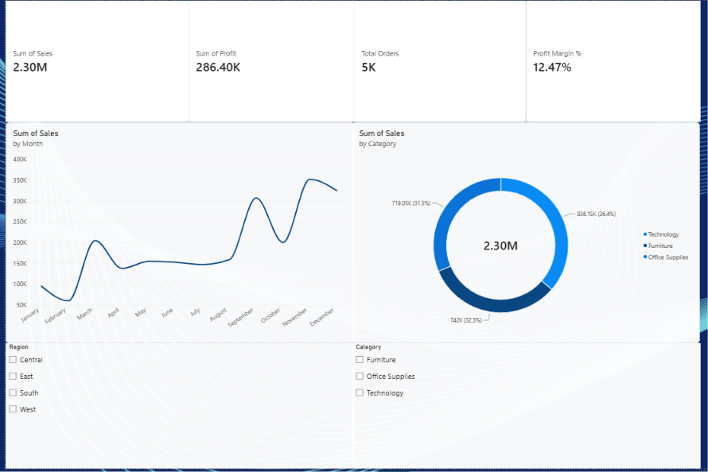
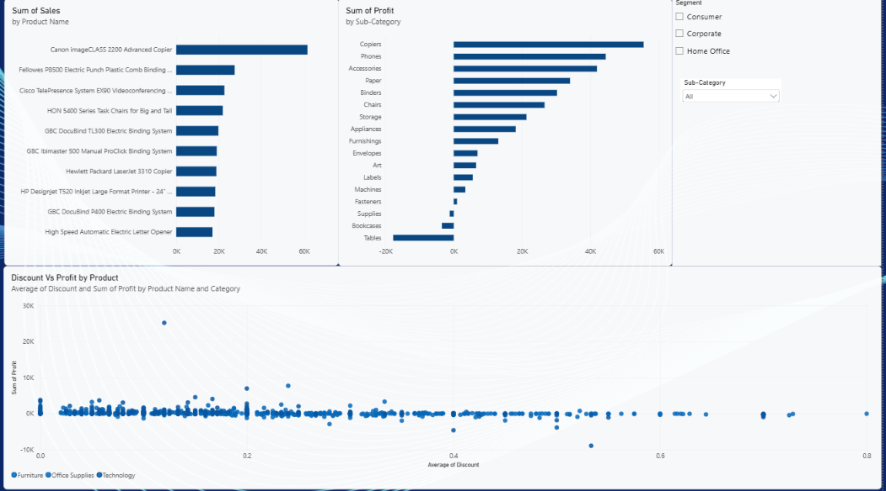
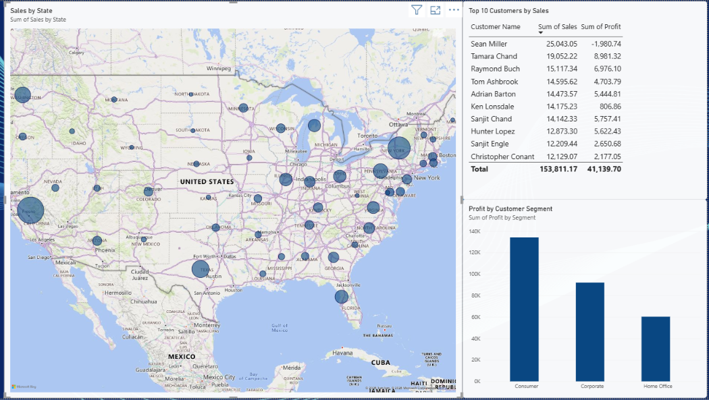

# Superstore Sales Dashboard (Power BI)

An interactive three-page Power BI dashboard built on the Superstore sales dataset. It covers executive KPIs, product and discount performance, and geographic and customer analysis.

## Overview

The goal of this project is to turn raw retail transaction data into a dashboard that answers practical business questions:

- How are sales and profit trending over the year?
- Which categories, sub-categories, and products drive profit, and which lose money?
- How does discounting affect profit?
- Where do sales concentrate geographically, and which customers and segments matter most?

## Dataset

- **Source:** [Superstore Dataset](https://www.kaggle.com/datasets/vivek468/superstore-dataset-final) by Vivek Chowdhury on Kaggle
- **File:** `Sample - Superstore.csv` (21 columns: orders, dates, customers, segments, geography, products, sales, quantity, discount, profit)
- **Note:** The dataset is public and sample data. Credit goes to the original author.

## Dashboard Preview

### 1. Executive Overview
KPI cards (Sales, Profit, Profit Margin %, Total Orders), monthly sales trend, sales by category, and Region / Category slicers.

### 2. Product Performance
Top 10 products by sales, profit by sub-category, and a scatter plot of discount vs. profit per product, with Segment and Sub-Category slicers.

### 3. Geographic & Customer Analysis
Sales by state (map), Top 10 customers by sales with their profit, and profit by customer segment. Clicking a segment cross-filters the map and the table.

## Key Insights

1. **Sales are seasonal.** Monthly sales climb in the second half of the year, with peaks in September and again in November-December.
2. **Technology leads in sales, but the mix is balanced.** Technology contributes 36.4% of total sales, with Office Supplies (32.3%) and Furniture (31.3%) close behind.
3. **Profit is concentrated in a few sub-categories.** Copiers is the most profitable sub-category (about $55K), while Tables (about -$17K), Bookcases, and Supplies are loss-making.
4. **Heavy discounting tends to erode profit.** Products with discounts up to about 20% are mostly profitable, while most products discounted above 40% sit at or below zero profit.
5. **Big sales do not guarantee big profit.** Sean Miller is the top customer by sales ($25.0K) but has negative profit (-$1.98K), while Tamara Chand ranks second in sales ($19.1K) with $8.98K profit.

## Headline Numbers

| Metric | Value |
| --- | --- |
| Total Sales | 2.30M |
| Total Profit | 286.40K |
| Profit Margin | 12.47% |
| Total Orders | ~5K |

## Tools & Techniques

- **Power BI Desktop**: data modeling, visuals, slicers, cross-filtering, theming
- **Power Query**: data type fixes (dates parsed with the English (United States) locale)
- **DAX measures:**
  - `Profit Margin % = DIVIDE(SUM(Profit), SUM(Sales), 0)`
  - `Total Orders = DISTINCTCOUNT(Order ID)`
  - `Average Order Value = DIVIDE(SUM(Sales), DISTINCTCOUNT(Order ID), 0)`

## How to Open

1. Download `superstore-dashboard.pbix` from this repository.
2. Open it with [Power BI Desktop](https://powerbi.microsoft.com/desktop/) (free, Windows).
3. Use the slicers and click on chart elements to explore. Clear all filters before comparing against the screenshots above.

## Author

**Muhammad Raffy Andriawan**
Fresh graduate in Informatics Engineering, Universitas Sriwijaya
[GitHub](https://github.com/raffyandriawan) | [LinkedIn](https://linkedin.com/in/raffyandriawan)
